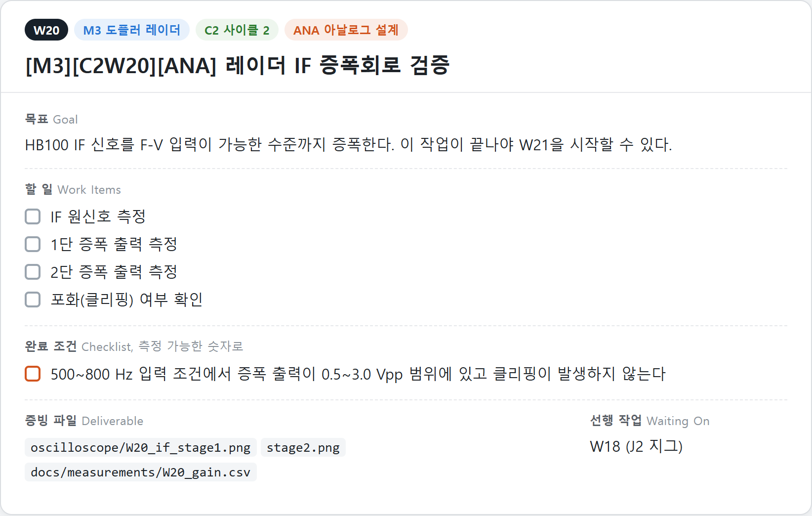

# IDEC 팀 운영 규격

IDEC 스마트 전자회로설계 챌린지 2인 팀 프로젝트(2026.11.11까지 진행 중)에서 발췌했습니다. 제 담당은 아날로그 회로, PCB, 시험 지그입니다.

이 폴더는 실행할 것이 없습니다. 이 README를 읽어 주시면 감사하겠습니다. 운영 규격 원문과 회로 설계 파일은 팀 저장소에 두고 이 폴더에는 README만 넣었습니다.

## 요약

작업 관리는 GitHub 저장소와 연동한 [Plane](https://plane.so)으로 했습니다. 팀 운영 규격을 직접 작성해 Claude에 지시문으로 제공했고, Claude는 회의와 결정 사항을 이 규격에 맞춰 작업 항목과 설계 문서로 정리했습니다. 작업 목록은 스크립트로 Plane에 등록했고, 등록 전에 규격을 지켰는지 스크립트로 검사했습니다.

형식과 완료 기준을 규격으로 먼저 정해 두었기 때문에 작업 51개가 모두 같은 형식과 숫자로 된 완료 조건을 갖췄습니다.

| 항목 | 결과 |
|---|---|
| 작업 | 51개 (모듈 8개, 사이클 13개) |
| 측정 가능한 완료 조건 | 280개 (작업당 평균 5.5개) |
| 증빙 파일 경로 | 178개 |
| 설계 결정 기록 | 28건 |
| 진행 판정 시점 (Go/No-Go) | 6곳 |

## 운영 규격의 핵심

1. **작업종류 8종.** 새 결론을 만드는 작업(RES)과 정리하는 작업(DOC)을 나눕니다. 기준은 "이 작업이 끝나면 프로젝트에 없던 결론이 생기는가" 한 문장입니다.
2. **작업마다 네 항목.** Goal, Work Items, Checklist, Deliverable을 씁니다. Checklist에는 "동작 확인", "정상 작동", "문제 없음"을 쓰지 않고 "리플 50 mVpp 이하"처럼 숫자로 씁니다. Deliverable은 파일 경로로 적습니다.
3. **바뀌지 않는 작업 번호.** `[M모듈][C사이클 W작업][종류]` 형식이고 W번호는 일정이 밀려도 바뀌지 않아 문서 사이의 참조가 깨지지 않습니다. 커밋 메시지에도 같은 번호를 붙여 회로가 바뀐 이유를 작업과 연결합니다.
4. **설계 결정 기록.** 결론, 근거, 검토한 대안, 재검토 조건을 함께 남깁니다.
5. **되돌리기 어려운 시점.** 부품 발주, PCB 발주처럼 되돌리기 어려운 6개 시점에는 진행 기준과 미충족 시 대응을 착수 전에 정합니다.

## Plane으로 관리하는 방법

작업 하나하나를 Plane의 작업 항목으로 만들고 할 일과 완료 조건을 체크리스트로 관리합니다.

1. 회의와 결정 사항을 Claude가 운영 규격에 맞춰 작업 항목으로 정리합니다
2. 스크립트가 규격을 지켰는지 검사한 뒤 Plane API로 작업, 모듈 8개, 사이클 13개를 등록합니다
3. 작업마다 상태를 Backlog, Todo, In Progress, Done 순서로 옮깁니다. 완료 조건을 모두 만족해야 Done이고 1인당 진행 중인 작업은 3개까지입니다
4. 혼자 풀 수 없고 일정에 영향을 주는 문제는 Blocked로 올리고 원인과 필요한 조치를 코멘트로 남깁니다
5. 커밋 메시지에 작업 번호를 붙여 GitHub의 변경 이력을 작업과 연결합니다

운영 규격에 적은 작업 항목의 작성 예시입니다. 할 일과 완료 조건을 체크리스트로 두고 완료 조건은 측정할 수 있는 숫자로 씁니다.

**등록 전에 스크립트가 검사한 것.** 작업종류가 8종 안인지, 완료 조건에 금지 표현이 있는지, 증빙이 파일 경로이고 파일명에 W번호가 있는지, 선행 작업 번호가 실제로 있는지, 번호 중복과 오타를 봤습니다. 51개가 확정된 뒤에는 등록 스크립트를 걷어내고 Plane 화면에서 운영하고 있어 스크립트는 이 폴더에 없습니다.
